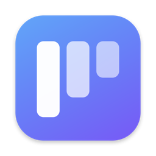
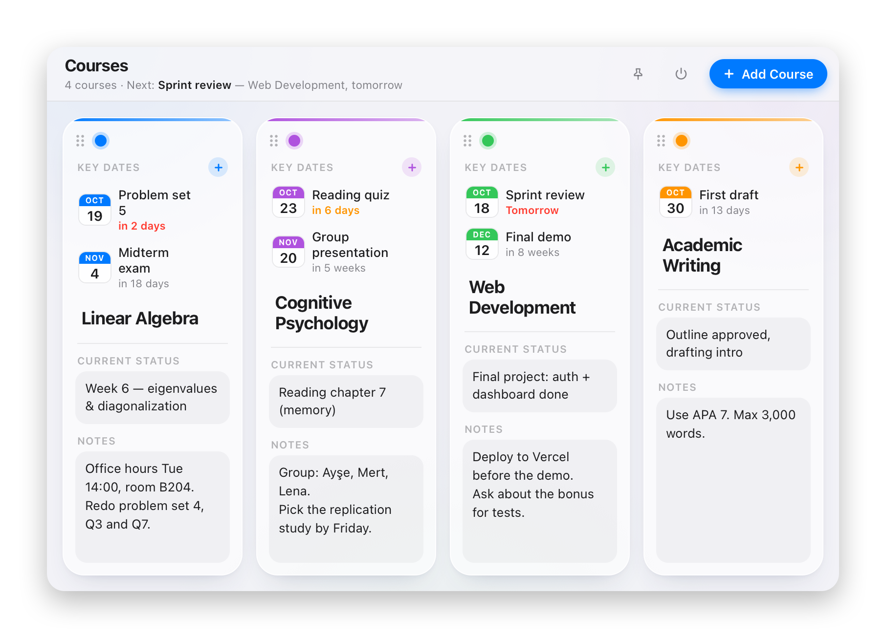

<div align="center">



# CourseS

**Your courses, one click away in the menu bar.**

Deadlines, status and notes for every course, in a single glanceable panel.


</div>

---

CourseS lives next to your Wi‑Fi and Bluetooth icons. Click it and a panel drops down with one column per course: upcoming dates with live countdowns, where you're at, and anything worth remembering. Click the icon again and it's gone.

<p align="center">
  <picture>
    <source media="(prefers-color-scheme: dark)" srcset="docs/screenshot-dark.png">
    
  </picture>
</p>

## ✨ Features

|   |   |
|---|---|
| 📅 **Key dates with countdowns** | Add exams and deadlines with **+**. Each shows how far away it is, in orange within a week and red within 2 days. |
| 🔎 **What's next, at a glance** | The header always shows your nearest upcoming date and which course it belongs to. |
| 📝 **Status and notes** | Every course has a "where am I" field and free-form notes. |
| 🗂 **Columns that grow with you** | Up to 8 courses per row. More courses start a new row below. |
| ↔️ **Reorder and color** | Drag ⠿ or use the ‹ › arrows to reorder. Tap the dot to change a course's color. |
| 📌 **Pin the panel** | Keep it open while you work in other apps. |
| 🌗 **Light and dark** | Follows your system appearance. |

## 🛡 Your data is never lost

- **Auto-save:** every edit is saved to `~/Library/Application Support/CourseS/courses.json`, and saved again on quit.
- **Daily snapshots:** one per day, kept for 30 days in `Snapshots/`. If the main file is ever damaged, the newest snapshot is loaded instead.
- **Safety net:** the app refuses to overwrite existing courses with empty data.
- **Undo:** deleted courses can be undone right away, or restored later from *Recently deleted*.

## 🪶 Lightweight

A native Swift app shell with a WebKit UI. No Dock icon, no timers and no background work, so it sits at about 0% CPU when idle.

## 🚀 Getting started

**Requirements:** macOS 13 Ventura or later, and the Xcode Command Line Tools (`xcode-select --install`).

```sh
git clone https://github.com/faithere1/CourseS.git
cd CourseS
./build.sh
open CourseS.app
```

`build.sh` compiles the app, draws its icon and bundles everything into `CourseS.app`. Rebuilding never touches your saved data.

> **Tip:** To launch CourseS automatically, add it under **System Settings → General → Login Items**.

## 🖱 Usage

| Action | How |
|---|---|
| Show / hide panel | Click the menu bar icon |
| New course | Click **Add Course** or press ⌘N |
| Add a key date | Click **+** on a course |
| Reorder | Drag ⠿, or use ‹ › |
| Keep panel open | Click the 📌 pin |
| Restore a deleted course | Click the *Recently deleted* button in the header |
| Show saved data / Quit | Right-click the menu bar icon |

## 🧱 Project structure

| File | Purpose |
| --- | --- |
| `src/main.swift` | Menu bar item, drop-down panel, saving to disk |
| `src/index.html` | The whole UI (HTML/CSS/JS, no dependencies) |
| `src/icon.swift` | Draws the app icon at build time |
| `src/Info.plist` | App bundle settings |
| `build.sh` | Compiles and bundles `CourseS.app` |

## 📄 License

[MIT](LICENSE) © faithere1

---

<div align="center">
<sub>Made with care for a calmer semester.</sub>
</div>
